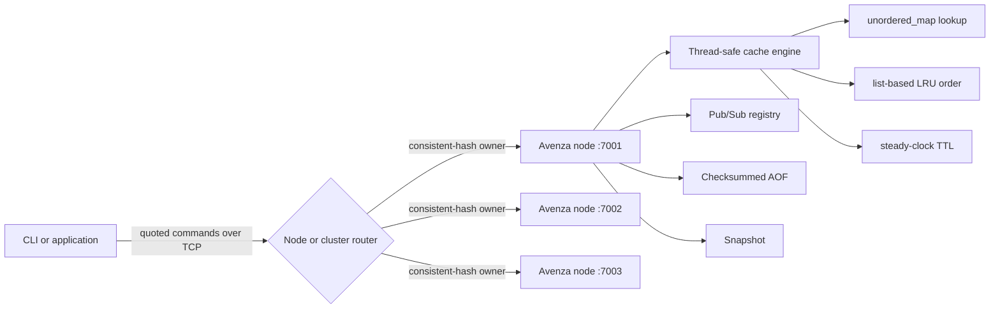

# Avenza — Distributed In-Memory Data Engine

> **Built for Speed. Engineered for Reliability.**

Avenza is a compact C++20 data engine for studying the systems behind fast, stateful network services. It stores key/value data in memory, bounds capacity with least-recently-used eviction, expires keys with per-entry TTLs, serves concurrent TCP clients, persists mutations, publishes transient messages, and partitions keys across a static multi-node cluster.

Avenza is an educational engineering project with explicit limits—not a claim of production readiness or enterprise durability.

## Motivation

A hash map alone does not make a dependable cache. A useful engine must keep lookup and eviction efficient together, define expiration semantics, frame arbitrary values across TCP, coordinate concurrent clients, recover state after restart, and decide where keys belong when several nodes participate. Avenza makes those mechanisms visible in a codebase that runs on an ordinary Windows or Linux machine.

## Core capabilities

- Average O(1) `SET`, `GET`, `DEL`, and LRU eviction
- Configurable entry capacity and TCP port
- Per-key expiration using `std::chrono::steady_clock`
- Multi-client Winsock/POSIX TCP server and interactive CLI
- Quoted line protocol supporting spaces and escaped characters
- Checksummed append-only file and snapshot recovery
- Thread-safe channel Pub/Sub with disconnect cleanup
- Deterministic consistent hashing with 128 virtual nodes per server
- Static three-node router with node, ring, and key-placement inspection
- Statistics, benchmark executable, behavior tests, Docker Compose, and CI

## Architecture



Each node owns independent data and persistence files. The cluster client chooses an owner; nodes do not replicate data.

## Request lifecycle

1. A client writes an LF-terminated command such as `SET profile "Ada Lovelace"`.
2. The session thread buffers partial TCP reads until a full line exists and rejects requests over 1 MiB.
3. The parser decodes plain or quoted tokens and validates escapes, arity, and integers.
4. The dispatcher calls the cache, persistence, or Pub/Sub component.
5. Cache operations lock the map, LRU list, TTL metadata, and counters as one invariant.
6. Successful persistent mutations append a checksummed AOF record.
7. The session returns one line. Pub/Sub messages use the same connection and a per-client output mutex.

## Technical stack

C++20, CMake 3.20+, the Standard Library, Winsock 2 on Windows, POSIX sockets on Linux, `std::thread`, mutexes, atomics, `std::chrono`, `unordered_map`, `list`, `map`, GoogleTest, Docker Compose, PowerShell, Bash, and GitHub Actions. No framework, cloud service, database, or orchestrator is required.

## Cache design and LRU eviction

The engine combines `unordered_map<string, Entry>` with a doubly linked `list<string>`. The map provides expected O(1) lookup. Each entry stores its list iterator, so access moves it to the MRU front with `list::splice`; deletion and eviction do not search. The LRU key is always at the list back.

| Operation | Expected time |
|---|---:|
| SET, GET, DEL, EXISTS | O(1) average |
| EXPIRE, TTL | O(1) average |
| LRU eviction | O(1) |
| FLUSHALL, SAVE | O(n) |
| Consistent-hash lookup | O(log v) |

Hash-table worst cases remain O(n). Capacity counts entries, not bytes.

## TTL implementation

Live deadlines use monotonic `steady_clock`, so wall-clock corrections do not alter an in-process TTL. Expired keys are removed lazily on access and during size/snapshot scans. Permanent keys report `TTL -1`; missing or expired keys report `-2`. Persistence converts remaining duration to a Unix-millisecond deadline and reconstructs a steady deadline after restart, accounting for offline time.

## TCP and concurrent clients

The server listens on a configurable port and starts one session thread per accepted client. Line buffering handles fragmented and coalesced packets. Quotes preserve spaces; supported escapes are `\\`, `\"`, `\n`, `\r`, and `\t`. Separate mutexes protect cache, Pub/Sub, persistence, and client output state. `GET` needs exclusive cache access because it changes recency and hit counters. This portable design is understandable, but not intended for millions of connections.

## Persistence: AOF and snapshots

The AOF records successful `SET`, `DEL`, `EXPIRE`, and `FLUSHALL` mutations. Reads and Pub/Sub traffic are not persisted. Each binary record contains a magic value, type, lengths, expiration deadline, and deterministic checksum. Recovery stops safely at an incomplete, oversized, unknown, or checksum-invalid trailing record while retaining the valid prefix.

`SAVE` writes live entries to a same-directory temporary snapshot, rotates the old snapshot, installs the replacement, then truncates the AOF. Startup loads snapshot first and AOF second. Streams are flushed, but explicit OS and directory `fsync` are not implemented, so power-loss durability depends on filesystem behavior.

## Pub/Sub architecture

`SUBSCRIBE` registers a callback by channel, `PUBLISH` fans out to current subscribers, and `UNSUBSCRIBE` removes it. Callbacks are copied under the registry lock and invoked after unlocking. Messages are transient: they are not stored, replayed, snapshotted, or assigned TTLs.

## Consistent hashing and cluster routing

The router hashes each node ID plus virtual-node index using deterministic 64-bit FNV-1a and stores 128 points per physical node. A key maps clockwise to the first point at or after its hash, wrapping at the end. Virtual nodes reduce skew; adding or removing a member changes adjacent ownership ranges.

Router-local commands are `NODES`, `RING`, and `MAP key`. Membership changes do not migrate values. If the selected owner cannot be reached, the router reports it. It does not automatically reroute because there is no replica that could safely answer.

## Repository structure

```text
Avenza/
├── CMakeLists.txt, Dockerfile, docker-compose.yml
├── include/                  # public engine headers
├── src/{cache,distributed,network,persistence,protocol}/
├── src/main.cpp
├── client/                   # direct and cluster-aware clients
├── benchmarks/
├── tests/                    # GoogleTest and offline integration suite
├── config/, scripts/, docs/
└── .github/workflows/
```

Internal API identifiers are deliberately retained to keep the proven implementation and tests stable. Public executables and presentation use Avenza.

## Windows setup

Install CMake and a C++20 compiler. Visual Studio 2022 Build Tools with Desktop development with C++ is recommended.

```powershell
winget install Kitware.CMake
winget install Microsoft.VisualStudio.2022.BuildTools
git clone <your-repository-url> Avenza
cd Avenza
cmake -S . -B build -DAVENZA_FETCH_GTEST=ON
cmake --build build --config Release --parallel 2
ctest --test-dir build -C Release --output-on-failure
```

For an existing copy, omit `git clone`. The helper performs the same workflow:

```powershell
.\scripts\setup.ps1 -BuildType Release -FetchGoogleTest
```

## Linux setup

```bash
sudo apt update
sudo apt install -y build-essential cmake git
git clone <your-repository-url> Avenza
cd Avenza
cmake -S . -B build -DCMAKE_BUILD_TYPE=Release -DAVENZA_FETCH_GTEST=ON
cmake --build build --parallel 2
ctest --test-dir build --output-on-failure
```

For offline builds, omit `AVENZA_FETCH_GTEST`; the dependency-free `avenza-self-test` remains available. An installed GTest CMake package is discovered automatically.

## Server and client usage

Windows multi-configuration build:

```powershell
.\build\Release\avenza-server.exe --port 7001 --capacity 10000 --data-dir .\data\node1
.\build\Release\avenza-cli.exe --host 127.0.0.1 --port 7001
```

Linux or single-configuration build:

```bash
./build/avenza-server --port 7001 --capacity 10000 --data-dir ./data/node1
./build/avenza-cli --host 127.0.0.1 --port 7001
```

```text
> PING
PONG
> SET username "Shivansh Kumar"
OK
> GET username
VALUE "Shivansh Kumar"
> EXPIRE username 60
1
> TTL username
60
```

Start three Windows nodes with `scripts/start-cluster.ps1`, or run nodes manually on 7001–7003, then:

```powershell
.\build\Release\avenza-cluster.exe 127.0.0.1:7001 127.0.0.1:7002 127.0.0.1:7003
```

## Command reference

| Command | Purpose | Response |
|---|---|---|
| `PING` | Connectivity check | `PONG` |
| `SET key value [EX seconds]` | Create or replace | `OK` |
| `GET key` | Read and refresh LRU position | `VALUE "..."` or `NIL` |
| `DEL key`, `EXISTS key` | Delete or test presence | `1` or `0` |
| `EXPIRE key seconds` | Set TTL; non-positive deletes existing key | `1` or `0` |
| `TTL key` | Remaining lifetime | seconds, `-1`, or `-2` |
| `FLUSHALL` | Remove all keys | `OK` |
| `STATS`, `INFO` | Counters and capacity | `name=value` fields |
| `SAVE` | Snapshot and compact AOF | `OK` or `ERR ...` |
| `SUBSCRIBE channel` | Register connection | `OK` |
| `UNSUBSCRIBE channel` | Remove subscription | `1` or `0` |
| `PUBLISH channel message` | Deliver live message | subscriber count |

See [the protocol reference](docs/PROTOCOL.md) for exact framing and escaping.

## Benchmark methodology and measured results

```powershell
.\build\Release\avenza-benchmark.exe 100000 10000
```

The benchmark preloads data, uses seed 42, measures individual in-process operations with `steady_clock`, sorts latency samples, and reports throughput plus average/P50/P95/P99. It does **not** measure TCP, persistence, or multi-thread scaling.

The verified local Release run used Clang 23.1.4, 100,000 operations, capacity 10,000, and reported 12 hardware threads:

| Workload | Throughput | Average | P50 | P95 | P99 |
|---|---:|---:|---:|---:|---:|
| SET | 1,704,370 ops/s | 0.509 µs | 0.4 µs | 0.9 µs | 1.2 µs |
| GET | 3,367,797 ops/s | 0.240 µs | 0.2 µs | 0.4 µs | 0.5 µs |
| 80% GET / 20% SET | 3,086,934 ops/s | 0.268 µs | 0.2 µs | 0.5 µs | 0.8 µs |

These are machine-specific local measurements, not general guarantees or network benchmark results.

## Testing and verification

Tests cover cache operations, LRU ordering, TTL, invalid keys, concurrency, quoted parsing, AOF and snapshot recovery, Pub/Sub filtering, hash-ring membership changes, TCP communication, and multiple clients. The latest verified Release run passed all 6 CTest entries: five discovered GoogleTests plus the integration suite. Separate live checks passed LRU, TTL, forced-restart AOF recovery, Pub/Sub between sockets, and three-node routing.

Docker Compose schema validation passed. Docker runtime/image verification was not completed because the Docker engine was unavailable.

## Docker and Compose

```bash
docker compose up --build -d
docker compose ps
docker compose logs -f avenza-node1
docker compose down
```

Compose exposes ports 7001–7003, gives each node a persistent volume, defines CLI health checks, and requests a ten-second shutdown grace period.

## Current limitations

- No replication, automatic failover, data migration, or consensus protocol
- No TLS, authentication, or transactions
- No Redis RESP compatibility
- No byte-based memory limits
- No event loop or bounded connection pool
- No OS-level `fsync` durability policy
- Unavailable cluster owners are reported rather than automatically rerouted

## Future improvements

Potential extensions include sharded locks, active expiration, a bounded worker pool or event loop, configurable sync policies, pipelined network benchmarks, fuzz/property tests, TLS authentication, membership epochs, explicit migration, and replication with a defined consistency model.

## Interview discussion points

Avenza supports concrete discussion of why a map alone cannot implement O(1) LRU, why `GET` writes recency state, steady versus wall clocks, TCP framing, lock boundaries, crash-tail recovery, snapshot/AOF ordering, transient versus durable messaging, consistent-hash redistribution, and why failure detection is not failover. [The interview guide](docs/INTERVIEW_GUIDE.md) provides a 60-second summary, detailed walkthrough, failure scenarios, trade-offs, and 45 implementation-specific questions.

## License

MIT. See [LICENSE](LICENSE).
