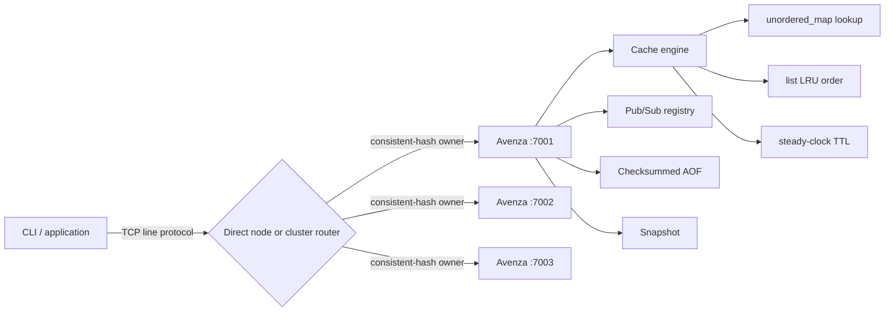

# Avenza — Distributed In-Memory Data Engine

**Built for Speed. Engineered for Reliability.**

Avenza is a C++20 in-memory key/value engine built to explore the engineering behind low-latency stateful services: constant-time cache access, LRU eviction, TTL expiration, TCP concurrency, durable recovery, transient messaging, and consistent-hash routing across multiple nodes.

This is an educational systems project with documented trade-offs—not a production-readiness claim.

## The problem

A bounded cache needs more than a hash map. It must evict the correct key without a linear scan, expire data safely, frame values across a byte stream, preserve invariants under concurrent clients, recover mutations after restart, and assign keys predictably when several servers participate. Avenza implements those mechanisms directly with the C++ Standard Library and native sockets.

## Engineering highlights

- Expected O(1) `SET`, `GET`, `DEL`, and LRU eviction using `std::unordered_map` plus `std::list`
- Per-key TTL deadlines based on monotonic `std::chrono::steady_clock`
- Winsock/POSIX TCP server with one managed session thread per client
- Quoted line protocol supporting spaces and escaped characters
- Checksummed binary append-only file and snapshot-based startup recovery
- Channel Pub/Sub with thread-safe subscription cleanup
- Deterministic FNV-1a consistent-hash ring with 128 virtual nodes per server
- Static cluster router with node, ring, and key-owner inspection
- Cache counters, reproducible in-process benchmark, GoogleTest, integration tests, Docker Compose, and CI

## Architecture



A request is buffered to LF, parsed into quoted tokens, validated, and dispatched. Cache operations hold one mutex across the map, LRU list, TTL metadata, and statistics. Successful mutations append to the AOF. Pub/Sub writes share the connection safely through a per-client output mutex.

## Technology

C++20 · CMake · Standard Library · Winsock/POSIX sockets · threads, mutexes, atomics · GoogleTest · Docker Compose · PowerShell/Bash · GitHub Actions

## Design summary

The cache map stores each entry’s iterator into a doubly linked LRU list. `GET` finds the entry and splices its node to the MRU front; eviction removes the list back and erases its map entry. These are expected O(1) operations. `GET` requires exclusive locking because it updates recency and hit counters.

TTL deadlines use `steady_clock` while the process runs. Persistence stores an absolute Unix-millisecond deadline so elapsed offline time is respected after restart. Expiration is lazy on key access and on full scans used by size/snapshot operations.

Persistence loads a snapshot first, then replays later AOF mutations. Each record has type, sizes, expiry, and checksum metadata; recovery retains the valid prefix and stops at a corrupt or incomplete trailing record. `SAVE` writes a temporary snapshot, replaces the previous snapshot, then truncates the AOF.

The cluster client uses stable 64-bit FNV-1a hashing and an ordered ring. Virtual nodes reduce placement skew. An unavailable owner is reported, not silently rerouted, because Avenza has no replica that could answer safely.

## Repository layout

```text
include/cacheforge/       Engine, networking, persistence, and ring APIs
src/                      Cache, protocol, persistence, network, and hashing implementations
client/                   Direct CLI and consistent-hash cluster client
benchmarks/               In-process latency/throughput benchmark
tests/                    GoogleTest cases and dependency-free integration suite
docs/                     Architecture and design references
scripts/                  Windows/Linux setup and cluster helpers
config/                   Example static cluster configuration
Dockerfile                Multi-stage Linux image
docker-compose.yml        Three-node local deployment
```

## Build and test

### Windows

Required components:

- CMake 3.20+
- Visual Studio 2022 Build Tools with **Desktop development with C++**
- A Windows 10 or 11 SDK, including headers and x64 libraries

From an **x64 Native Tools Command Prompt for VS 2022**:

```powershell
cmake -S . -B build -G "Visual Studio 17 2022" -A x64 -DAVENZA_FETCH_GTEST=ON
cmake --build build --config Release --parallel 2
ctest --test-dir build -C Release --output-on-failure
```

Clang 23 with Ninja also works after the same MSVC runtime and Windows SDK environment is initialized:

```powershell
cmake -S . -B build-clang -G Ninja -DCMAKE_CXX_COMPILER="C:/Program Files/LLVM/bin/clang++.exe" -DCMAKE_BUILD_TYPE=Release -DAVENZA_FETCH_GTEST=ON
cmake --build build-clang --parallel 2
ctest --test-dir build-clang --output-on-failure
```

The inspected machine has CMake 4.4.4, Ninja 1.13.2, Clang 23.1.4, MSVC 14.44 runtime libraries, and Windows SDK 10.0.26100.0. A system-native Clang/Ninja Release build was configured and linked successfully. No system software or global `PATH` setting was changed during this audit.

### Linux

```bash
sudo apt update
sudo apt install -y build-essential cmake git
cmake -S . -B build -DCMAKE_BUILD_TYPE=Release -DAVENZA_FETCH_GTEST=ON
cmake --build build --parallel 2
ctest --test-dir build --output-on-failure
```

Set `AVENZA_FETCH_GTEST=OFF` for an offline build; `avenza-self-test` remains available without GoogleTest.

## Run

```powershell
.\build\Release\avenza-server.exe --port 7001 --capacity 10000 --data-dir .\data\node1
.\build\Release\avenza-cli.exe --host 127.0.0.1 --port 7001
```

Single-configuration builds place binaries directly in `build/` rather than `build/Release/`.

```text
> SET profile "Aparna Software Engineer"
OK
> GET profile
VALUE "Aparna Software Engineer"
> EXPIRE profile 60
1
> TTL profile
60
```

Commands: `PING`, `SET key value [EX seconds]`, `GET`, `DEL`, `EXISTS`, `EXPIRE`, `TTL`, `FLUSHALL`, `STATS`, `INFO`, `SAVE`, `SUBSCRIBE`, `UNSUBSCRIBE`, and `PUBLISH`. See [DEMO.md](DEMO.md) for a complete walkthrough and [docs/PROTOCOL.md](docs/PROTOCOL.md) for response framing.

## Benchmark evidence

```powershell
.\build\Release\avenza-benchmark.exe 100000 10000
```

The benchmark uses seed 42 and measures the cache engine in-process with `steady_clock`; it does **not** measure TCP, persistence, or multi-threaded scaling. A verified Release run with Clang 23.1.4, 100,000 operations, capacity 10,000, and 12 reported hardware threads produced:

| Workload | Throughput | Average | P50 | P95 | P99 |
|---|---:|---:|---:|---:|---:|
| SET | 2,141,749 ops/s | 0.417 µs | 0.3 µs | 0.9 µs | 1.3 µs |
| GET | 4,570,968 ops/s | 0.185 µs | 0.2 µs | 0.4 µs | 0.5 µs |
| 80% GET / 20% SET | 2,719,623 ops/s | 0.318 µs | 0.2 µs | 0.7 µs | 1.2 µs |

Results are machine-specific measurements, not general performance guarantees.

## Verification evidence

The existing suite checks cache operations, LRU ordering, TTL, invalid keys, eight-thread access, parsing, snapshot/AOF recovery, Pub/Sub isolation, ring membership changes, TCP communication, and multiple clients. The latest verified run passed all 6 CTest entries: five discovered GoogleTests and the integration self-test. Docker Compose schema validation passed; Docker image/runtime verification was not completed because its engine was unavailable.

## Docker

```bash
docker compose up --build -d
docker compose ps
docker compose logs -f avenza-node1
docker compose down
```

## Limitations

- No replication, automatic failover, data migration, or consensus
- No TLS, authentication, transactions, or Redis RESP compatibility
- Capacity is entry-based, not byte-based
- One thread per client and one cache mutex limit scalability
- Lazy rather than active expiration
- Stream flush without an explicit OS `fsync` durability policy
- Static cluster membership; unavailable owners are reported instead of rerouted

## Developer

**Aparna**

- [Portfolio](https://portfolio-aparna-2acc.vercel.app/)
- [GitHub repository](https://github.com/creativebitscore/avenza-distributed-data-engine)

MIT licensed.
